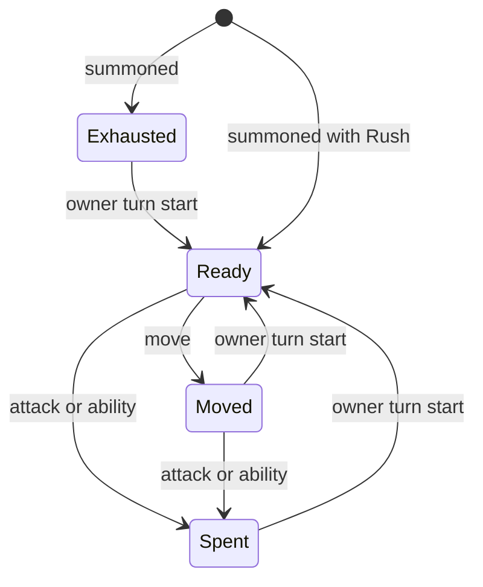
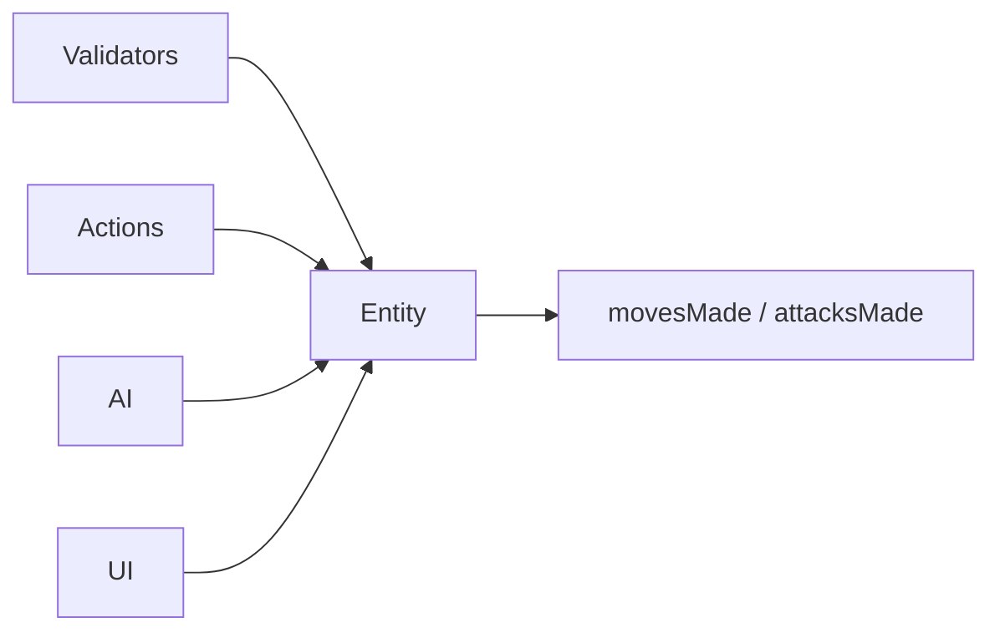

# Architecture Spine — Duelyst Action Model and Rush

## Design Paradigm

Version 2 stops having its own action budget. A unit's turn is the original pair of slots, one move then one attack, kept by `Entity.movesMade` and `Entity.attacksMade`. Direct attacks, active abilities and the General's Bloodbound ability all spend the attack slot through the same Entity methods; nothing else decides whether a unit may act. Rush is the existing Rush modifier on one card.





Dependency direction: validators, actions, AI and UI read and write slot state only through `Entity`; `Entity` depends on nothing above it.

## Inherited Invariants

| Inherited | From parent | Binds here |
| --- | --- | --- |
| AD-1 | duelyst spine | Every v2 check goes through the one v2 helper; ruleset stays version 2. |
| AD-3 | duelyst spine | Slot rules are enforced in SDK actions and validators, never UI-only. |
| AD-6 | duelyst spine | Only Entity accessors decide can-move and can-attack. **Its two-action-point clause is superseded by AD-18.** |
| AD-7 | duelyst spine | One ability action, no mana, both counters zero, live, not silenced. **Its "spends one action point" clause is superseded by AD-19.** |
| AD-8 | duelyst spine | Ranged and area geometry is resolved in one place (`hexAttackGeometry`). CAP-3 adds enemy-unit obstruction for ranged attacks inside that resolver only; Behold keeps its Wall-only rules and its piercing beam. |
| AD-13 | phobies spine | Numeric ruleset constants live in the v2 config; this spine adds none. |
| AD-14 | phobies spine | Passives are modifiers on existing hooks. |
| AD-15 | phobies spine | Reuse before create. |
| AD-17 | phobies spine | Ability execution semantics, including Silence, stun and Lockdown/Cooldown, are unchanged. |

## Invariants & Rules

### AD-18 — v2 uses the original move and attack slots [ADOPTED]

- **Binds:** CAP-1; Entity, move and attack actions, validators, AI, card UI, serialization, transforms.
- **Prevents:** A second action budget beside the slots, or modifiers and validators branching on a different count.
- **Rule:** In v2, `Entity` decides readiness only from `movesMade` and `attacksMade`, compared with the buffed `getMoves()` and `getAttacks()` (default one each); uncontrollable battle pets keep their original exemption. The existing coupling stays: `setAttacksMade` raises `movesMade` to at least `attacksMade`, so a unit cannot move after attacking, and `setMovesMade` keeps `attacksMade` at least `movesMade - 1`. `getHasActedThisTurn` is `movesMade != 0 or attacksMade != 0`. Everything action-point is removed, not repurposed: Entity fields, accessors, flags and branches (`actionPoints`, `actionPointsSpentThisTurn`, `getUsesActionPoints`, `getActionPoints`, `setActionPoints`, `spendActionPoint`, `getHasSpentActionPointThisTurn`, `getIsOutOfActionPoints`, `recordActiveAbilityUse`, `restoreActionPointState`, and the action-point branches in `getHasMovesLeft`, `getHasAttacksLeft`, `getHasActedThisTurn`, `setExhausted`, `refreshExhaustion`, `applyExhaustion`); the action-point fields of `SetExhaustionAction`; the two positional action-point parameters of `ModifierTransformed.createContextObject` and every call site that passes them (sweep all callers, keep arguments aligned); the v2 branch of `getBuildingTransformState`. Every external caller of a removed method moves to the accessor in AD-19. Supersedes the action-point clause of parent AD-6; the parent stats clauses are unchanged.

### AD-19 — Abilities spend the attack slot [ADOPTED]

- **Binds:** CAP-1; `UseActiveAbilityAction`, the General's Bloodbound ability, validators (`validatorPlayCard`, `validatorEntityAction`), `handAbilitySlot`, `starter_ai`.
- **Prevents:** An attack and an ability in one turn, a move after an ability, two ability gates, or embedded actions that cost a slot or are rejected by it.
- **Rule:** One accessor, `Entity.getCanUseActiveAbility`, gates ability use: the unit is not exhausted and `attacksMade < getAttacks()` (the `getHasAttacksLeft` test), with no attack-strength, reach or attack-type requirement, so attack-less units can use abilities. The validator is the only authority; UI and AI call the accessor and never re-derive it. The AD-7 conditions still apply. The action validates, then records the slot with `Entity.recordAttack` (the same call as a direct attack, replacing `recordActiveAbilityUse`), then runs embedded actions. An embedded move or attack carries `isAbilityOrigin`: it passes the Entity readiness checks (`getCanMove(true)` and `getCanAttack(true)` ignore slot state) and its execution does not call `recordMove` or `recordAttack`; `moveAction` and `attackAction` are the sites that change. The General and its Bloodbound ability use the same path and keep their AD-7 slot identity. No ability-used flag exists. Only an executed move records a move; a rejected or zero-tile move leaves the slot untouched. Supersedes the action-point clause of parent AD-7; Lockdown, Cooldown and the rest of AD-7 are unchanged.

### AD-20 — Exhaustion and refresh follow the original path [ADOPTED]

- **Binds:** CAP-1, CAP-2; summon actions, turn start, setup, allegiance swap, exhaustion actions.
- **Prevents:** Summons that act on their summon turn, refresh logic that differs by unit kind, or two mutators of exhaustion.
- **Rule:** `Entity.applyExhaustion`, `refreshExhaustion` and `setExhausted` are the only mutators of exhaustion and slot reset. Exhaustion actions and the existing direct call sites (turn start in `gameSession`, `Unit` apply-to-board, allegiance swap, game setup, challenge setup) call them, and nothing else writes `exhausted`, `movesMade` or `attacksMade`; the existing setter calls in `ModifierTransformed`, `ModifierPseudoRush`, `ModifierSpawnedFromEgg` and `SetExhaustionAction` stay as they are. A summoned unit is exhausted on the summon turn. Turn start refreshes the owner's units through `refreshExhaustion`, which resets `exhausted`, `movesMade` and `attacksMade`; the implementing story keeps the existing turn-start scope branch and verifies it against the spec (refresh at the owner's next turn start). `getIsExhausted` is the original expression (exhausted flag or no attack left). Generals, units and Rush units share this path.

### AD-21 — Rush is the existing Rush modifier [ADOPTED]

- **Binds:** CAP-2; Rock Pulverizer (Phobies card 50004, Cassowary in `cardsLookup`), card text, effect 51012.
- **Prevents:** A second Rush implementation, Rush that grants more than the summon-turn move and attack, or deleting effect 51012 while references remain.
- **Rule:** Rock Pulverizer carries `ModifierFirstBlood` as a card passive (AD-14). Its refresh runs only when the unit has not acted (`getHasActedThisTurn`, AD-18) and clears only the summon exhaustion; a stun or other exhaustion source still applies, and a state copied by `ModifierTransformed` is not overridden by Rush. The card's active-ability mapping (its `ROSTER` and `ACTIVE_ABILITY_BY_CARD_ID` rows) is removed. Effect 51012 (`move_and_strike`) is retired only after searching every reference: the effect factory entry, the `validatorEntityAction` Phobies movement-attack id list, AI card-intent data, `PhobiesCollectionCardVisual`, `abilities.coffee`, `cardsLookup` and tests. "No other card has Rush" means no other Phobies card; original cards using the same modifier are unchanged. Stats and Lifegain are untouched.

### AD-22 — No compatibility with action-point data [ADOPTED]

- **Binds:** CAP-1; card-data keys, `SetExhaustionAction` shape, serialization, snapshots, replays.
- **Prevents:** Migration code or a ruleset version bump for data that is being discarded.
- **Rule:** Snapshots and replays recorded under the two-action-point rule are discarded. Ruleset stays version 2 (AD-1). `actionPoints` and `actionPointsSpentThisTurn` leave the stat card-data keys, `SetExhaustionAction` and serialization and are ignored if read; no migration or compatibility code is written. Precondition for implementing: confirm that stored snapshots carry `exhausted`, `movesMade` and `attacksMade`, which the stat card-data keys do not include.

### AD-23 — One predicate decides whether a Wall obstructs a summoned unit [ADOPTED]

- **Binds:** CAP-4; `ValidatorApplyCardToBoard`, hand-summon position generation, effect-created summons (spawn, clone and summon spells and modifiers), AI, placement highlighting.
- **Prevents:** The validator allowing a fly or phase unit on a Wall while a hand or effect position generator still rejects it (or the reverse), and the exemption leaking into teleports or movement.
- **Rule:** The Wall exemption for fly and phase units is decided in exactly one board predicate, used both by `ValidatorApplyCardToBoard` and by every producer of summon positions that today calls `Board.getObstructionAtPositionForEntity` for a unit about to be applied to the board. Walk units are unaffected. Teleport and move paths keep their existing obstruction logic. A hole still requires a tile; hand summons keep the General-adjacent restriction; effects keep their own placement constraints. The Wall stays a separate entity at the shared position.

## Consistency Conventions

| Concern | Convention |
| --- | --- |
| Slot access | Only Entity accessors and `recordMove` / `recordAttack`; direct writes only at the AD-20 call sites. |
| Ability gate and cost | `getCanUseActiveAbility` and `recordAttack` (AD-19). |
| Embedded actions | `isAbilityOrigin` bypasses the slot check and skips recording (AD-19). |
| Exhaustion changes | Entity mutators via exhaustion actions or listed call sites (AD-20). |
| Rush | `ModifierFirstBlood`; no new Rush modifier (AD-21). |
| v2 test | The one v2 helper (AD-1). |
| Ranged obstruction | Only `hexAttackGeometry`; enemy-unit blocking for ranged attacks only (AD-8, CAP-3). |
| Summon placement | Only the AD-23 predicate. |

## Structural Seed

```text
app/sdk/entities/entity.coffee      # slot state, recordMove / recordAttack, exhaustion
app/sdk/actions/                    # move, attack, use-active-ability, exhaustion actions
app/sdk/validators/                 # entity action and play-card validators
app/sdk/cards/factory/phobies/      # Rock Pulverizer entry
server/ai/                          # practice AI sequencing
```

## Capability → Architecture Map

| Capability | Lives in | Governed by |
| --- | --- | --- |
| CAP-1 move-then-attack model | Entity, actions, validators, AI, card UI | AD-1, AD-3, AD-18, AD-19, AD-20, AD-22 |
| CAP-2 Rock Pulverizer Rush | Phobies factory, Rush modifier, card text | AD-14, AD-15, AD-20, AD-21 |
| CAP-3 enemy units block ranged attacks | `hexAttackGeometry`, attack range, AI, view targeting | AD-8 (inherited), AD-3 |
| CAP-4 fly/phase summon onto Walls | Board obstruction predicate, apply-to-board validator, summon spells and modifiers | AD-1, AD-23 |

## Deferred

- Whether the UI should tell an ability-used unit from an attacked unit apart; no current need, add an AD if one appears.
- Building transform state: restore the original fresh state on completion; carried state needs a spec change.
- Action-point display is gone with the model and not replaced.
- Deployment, infrastructure and operations: no change; this runs inside the existing shared SDK.
