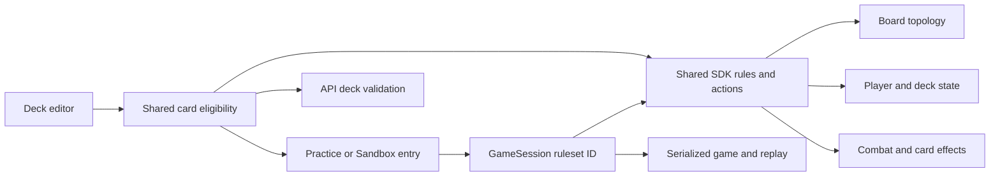

# Architecture Spine — Duelyst Practice and Sandbox rules overhaul

## Design Paradigm

Use one immutable, versioned ruleset per match within the existing shared SDK. The launch path selects the ruleset; SDK game state and actions enforce it; API and UI consume the same eligibility contract. Existing matches retain the legacy ruleset.

## Invariants & Rules

### AD-1 — Bind a ruleset to each match [ADOPTED]

- **Binds:** CAP-1–CAP-5; Practice, Sandbox, Developer Sandbox, legacy modes; saved matches and replays.
- **Prevents:** A board using hex rules while its mana or deck uses legacy rules, or Developer Sandbox accidentally inheriting Sandbox changes.
- **Rule:** The server derives ruleset ID `practice-sandbox-hex` from the validated Practice route (the only caller that creates `GameType.SinglePlayer` games; matchmaker bot fills use their own queue game type); local Sandbox setup derives the same ID from the concrete Sandbox class before setup. Version `1` is the original package; version `2` is the one rules package for new Practice and Sandbox matches after rollout (replacement battlefield, unit stats, action points, active abilities), and entry paths select it while players never choose a version. Version `1` matches and replays keep their own map, coordinates, and execution path and are never reinterpreted as version `2`. Every SDK, view, and server check for version `2` goes through the single helper `Rulesets.isPracticeSandboxV2` (exposed as `GameSession.getIsPracticeSandboxV2`); inline ID-plus-version comparisons are not allowed. Clients cannot choose the ruleset ID. Developer Sandbox and all other entries select `legacy`; `GameType.Sandbox` alone is insufficient. Persist the selected ID/version once in session and setup snapshots. Resolve it before board or deck construction and before replaying actions; reject unknown IDs/versions. Only historical snapshots with no ID default to `legacy`.

### AD-2 — Use one axial topology [ADOPTED]

- **Binds:** CAP-1, CAP-2; board state, targeting, movement, range, adjacency, AI, action payloads, server, and replay.
- **Prevents:** Mixed square-grid offsets, inconsistent hex distance, and mismatched stored positions.
- **Rule:** Every new-ruleset SDK position, action target, modifier target, snapshot, and replay uses `{q,r}`; legacy matches retain `{x,y}`. All SDK position producers and consumers, including AI, dispatch by ruleset; conversion is limited to explicit legacy input and display adapters. Both versions share one on-board domain: five horizontal pointy-top rows of lengths 9, 8, 9, 8, 9 (43 positions) with odd rows shifted half a cell right. Rendered column `c` and row `k` relate to `{q,r}` by `c = q + floor(r/2)` and `k = r`, and inversely `q = c - floor(k/2)` and `r = k`; a position is on board when `0 <= k < 5` and `0 <= c < rowLength[k]`. Shared topology code owns this conversion and exposes separate on-board and has-tile checks; no other code converts, and map positions authored as `(row, column)` convert through it. Version 1 has a tile on every on-board position. Version 2 keeps the same domain and `{q,r}` positions, removes the tile at its holes (which stay addressable positions), and takes walls, Methron Points, and starts from `map-layout.md`. The core spec's 45-cell footprint and the earlier `c = 2q + r` mapping were never implemented and are superseded by this definition. The only axial neighbor deltas are `(1,0)`, `(-1,0)`, `(0,1)`, `(0,-1)`, `(1,-1)`, and `(-1,1)`. Shared topology code owns conversion, neighbors, distance, paths, range, and bounds. In version 1 the general start cells are `(-1,2)` and `(7,2)`, the leftmost and rightmost cells of the center row. No new-ruleset legality or effect code may use square offset patterns.

### AD-3 — Enforce rule effects in SDK actions [ADOPTED]

- **Binds:** CAP-2–CAP-4; client prediction, authoritative play, and replay.
- **Prevents:** UI-only restrictions or card-specific exceptions diverging from authoritative outcomes.
- **Rule:** The ruleset's SDK action validation enforces general-adjacent summon destinations and suppresses automatic counterattacks. The SDK owns each player's reserve and spendable mana. Opening balances are `(17,3)` and `(16,4)`; `p_endTurn` transfers `min(3,reserve)` once for its recorded ending player before publishing `end_turn`, so observers see the new balance. Card play spends spendable mana. New-ruleset setup omits bonus mana tiles, and all other mana-grant actions are excluded by the eligibility policy or guarded by the ruleset. Start-turn refresh, nine-mana capping, and unspent-mana clearing are disabled only for the new ruleset. Turn-end state changes inside `p_endTurn` are limited to the recorded ending player's active-ability counter decrement (version 2) and then the reserve transfer, in that order, before the turn is marked ended and `end_turn` is published; every other state change, including Methron Point capture and control damage (AD-9), is an SDK action. Actions and resulting state serialize deterministically.

### AD-4 — Keep new decks and hands mode-specific [ADOPTED]

- **Binds:** CAP-5; deck editor, API validation, game setup, and replay.
- **Prevents:** A 40-card deck entering a new-rules match, or new hand logic changing legacy modes.
- **Rule:** Saved deck purposes are `practice`, `sandbox`, or `legacy`; old decks default to `legacy`. Practice and Sandbox entry each require a deck with the matching purpose and exactly one general plus eight cards; existing 40-card decks remain untouched. New-ruleset deck construction, deserialization, mutation, and UI use eight slots, encoded as a length-eight array with stable indices and `null` for spent slots; play actions identify the slot and card instance, then clear that entry without splicing. Turn-end draw, mulligan, replacement, fatigue, refill, shifting, and later hand additions are unavailable; active abilities (AD-7) never write to or reorder this array. The Practice server route and local Sandbox SDK launch each reject an invalid deck before setup using the same policy; UI mirrors these constraints. This check precedes the existing `allCardsAvailable` bypass.

### AD-5 — Publish one audited card eligibility set [ADOPTED]

- **Binds:** CAP-2–CAP-5; player decks, Practice bot deck, and card effects.
- **Prevents:** A conflicting card slipping through one entry path or a local blacklist drifting from another.
- **Rule:** One shared SDK allowlist of explicit card IDs is the source of truth for both new modes; variants need their own audited IDs. Audit each admitted card's modifiers, follow-ups, generated cards, and general/signature effects against hex targeting, general-only summoning, no counterattack, reserve-only mana grants, and fixed hand slots. Apply the policy at editing, Practice API entry, local Sandbox launch, Practice bot setup, and generated-card creation; reject non-allowlisted cards at authoritative boundaries. Practice uses the exact fixed bot roster in `practice-bot-deck.md` with all eight cards in hand regardless of difficulty; Maw's nearby effect must use hex neighbors before the roster is admitted. A substituted or partly unavailable roster cannot ship. The bot roster is its own explicit list sized to the deck limit minus the general and is not derived from the deck-eligible neutral list, which may be larger (Planar Scout is deck-eligible only). Legacy modes do not use this allowlist.

### AD-6 — Model unit stats and action points once [ADOPTED]

- **Binds:** Stats CAP-1–CAP-3, Stats CAP-6; entities, modifiers, actions, validators, card UI, and replay in version 2.
- **Prevents:** Two competing action-budget models, modifiers each forking on action points, and stats that invent mechanics parallel to existing ones.
- **Rule:** Every unit exposes movement type, movement distance, attack type, attack range, and level as explicit stats with defaults (walk, 2, melee, 1, level 1). Walk, fly, melee, ranged, and area reuse existing mechanics; Phase is a keyworded modifier in the style of Flying that differs only by passing through enemy units. In version 2 each unit has two action points per turn, refreshed at its owner's turn start and spent one per move, attack, or ability use, and they are the sole authority for whether a unit may act; version 1 keeps `moves` and `attacks`. Only `Entity` accessors decide whether a unit can move or attack; modifiers, actions, and validators call them and never branch on action points themselves, and branch on ruleset version only through the AD-1 helper. In version 2 a unit is exhausted exactly when it has zero action points, and refresh runs through the same entity refresh path at the owner's turn start. Stat and action-point fields are part of card data copy and serialization.

### AD-7 — One active-ability model for units and generals [ADOPTED]

- **Binds:** Ability CAP-4–CAP-5; unit and General abilities, hand slots, `UseActiveAbilityAction`, validators, and replay.
- **Prevents:** A separate state machine for the General's Bloodbound ability, divergent counter rules, and getters that create state on read.
- **Rule:** An ability is a definition `{effectCardId, lockdown, cooldown}` attached to card data plus a per-entity `activeAbilityState` holding current and base counters and the fixed hand-slot index; the General's Bloodbound Spell uses the same model on the General entity, and no player-level ability state exists. Use is one action type, registered and serialized like other explicit actions, resolving the effect through an existing spell card; it costs no mana, requires both counters at zero, a live unit, and no silence, spends one action point, and resets Cooldown to its base. Lockdown and Cooldown do not decrease at turn end while the unit is silenced; they resume from the same values when silence ends. The hand array keeps `null` in the granting unit's slot; the ability card shown there is a view derived from `activeAbilityState`, usable only through this action. The General has no hand slot: its Bloodbound ability keeps its dedicated slot, identified separately from hand indices. Counters decrement only per AD-3. State is created by explicit initialization when the unit enters play or the version 2 ruleset is assigned, never inside a getter, and is cleared when the unit leaves the board.

### AD-8 — Resolve ranged and area geometry in one place [ADOPTED]

- **Binds:** Map CAP-4; area and ranged attacks, spell area effects, Wall obstruction, and AI targeting in version 2.
- **Prevents:** Spells and area-attack units applying different Wall blocking, and attack actions carrying private geometry.
- **Rule:** Target selection for ranged, lobbed, and area attacks and spell area effects, including Wall obstruction and the target-supporting-Wall exception, is computed by one shared SDK resolver over the shared topology. `AttackAction` calls it and does not compute geometry itself. Lobbed attacks ignore intervening obstructions.

### AD-9 — Methron Points and Walls are neutral tile entities [ADOPTED]

- **Binds:** Map CAP-3–CAP-4; setup, board tiles, turn-end resolution, movement range, and replay in version 2.
- **Prevents:** A second ownership store for Methron Points, capture or damage resolved in view code or ad hoc turn-end hooks, and Walls modeled differently by movement, attacks, and area effects.
- **Rule:** Version 2 setup places five Methron Points and nine Walls as neutral tile entities with no owner; Methron ownership is the tile's owner and nothing else. After the turn-ending action resolves, for either player's turn, the session appends two automatic SDK actions in order: capture update, then control damage to the General of the player controlling fewer points (two damage per point of deficit). Both are authorized by `GameSession` and are no-ops outside version 2. Movement range owns which terrain each movement type may cross or occupy, and the AD-8 resolver owns attack and area obstruction and occupant priority; neither duplicates the other.

## Consistency Conventions

| Concern | Convention |
| --- | --- |
| Ruleset identity | Stable ID and version are match data, never inferred from `GameType` during replay. |
| Coordinates | Axial `{q,r}` is the sole new-ruleset SDK and wire position shape; `{x,y}` remains legacy. Display conversion happens at view adapters. |
| State mutation | SDK actions mutate match state, except turn-end changes inside `p_endTurn` (AD-3); UI offers previews and API validates entry. |
| Compatibility | Old saved sessions lacking a ruleset ID and existing decks resolve to legacy behavior. |
| Version gate | One helper decides version 2; no inline ID-plus-version comparison (AD-1). |
| Action budget | `Entity` accessors are the only authority on whether a unit can act (AD-6). |
| Ability state | Per-entity `activeAbilityState`, initialized explicitly, mutated by the ability action and `p_endTurn` only (AD-7). |
| Turn end | `p_endTurn`: counter decrement, then reserve transfer; then automatic capture, then control damage actions (AD-3, AD-9). |
| Geometry | One shared resolver owns ranged, lobbed, and area targeting and Wall obstruction (AD-8). |
| Delivery sequence | Implement and integrate board → summoning → counterattack → mana → deck and hand, as required by the Spec. |

## Structural Seed

The new ruleset, axial topology, and card eligibility policy live in the shared `app/sdk` code used by browser and server. `GameSession` owns ruleset identity; `Board` and geometry helpers consume topology; actions mutate player and deck state. Existing API and local Sandbox entry paths enforce the same eligibility contract. No new service or datastore is required by this feature. Unit stats, action points, and ability state live on `Entity` and `Card` data in the same `app/sdk` code. Existing Firebase game snapshots and replays carry the ruleset ID and new-ruleset coordinates; old snapshots remain legacy.

## Capability → Architecture Map

| Capability | Lives in | Governed by |
| --- | --- | --- |
| CAP-1 board | SDK board/topology, game view | AD-1, AD-2 |
| CAP-2 summoning | SDK board and summon action validation | AD-1–AD-3, AD-5 |
| CAP-3 counterattack | SDK attack/modifier action resolution | AD-1, AD-3, AD-5 |
| CAP-4 mana | SDK player and turn/card actions | AD-1, AD-3, AD-5 |
| CAP-5 deck and hand | SDK deck/setup, UI deck editor, API validation | AD-1, AD-4, AD-5 |
| Map spec CAP-1–CAP-4 battlefield, Methron Points, Walls | SDK board/topology, setup, turn-end actions, area resolver, game view | AD-1, AD-2, AD-3, AD-8, AD-9 |
| Stats spec CAP-1–CAP-3, CAP-6 stats and action points | SDK entity, modifiers, move and attack actions | AD-1, AD-6 |
| Stats spec CAP-4–CAP-5 active abilities | SDK entity, ability action, hand slots, card UI | AD-1, AD-3, AD-4, AD-7 |

## Deferred

- The physical store and UI layout for mode-specific deck identities can follow existing deck persistence patterns; the identity and validation contract above are fixed.
- The complete compatible card ID set is an implementation audit output. No unaudited card enters the new modes.
- Visual hex art and animation details belong to UI implementation; they must render the topology and fixed hand slots defined here.
- Level mechanics, an ability roster beyond the Planar Scout placeholder, and showing action points on cards are deferred to later specs; the stat, ability, and action-point contracts above stay fixed.
- Rollout of version 2: the switch, handling of in-flight version 1 matches, and browser/server SDK version skew follow existing release practice; the version 1 execution path stays until a separate decision retires it. Saved version 2 matches that carry player-level signature ability state need a migration when AD-7 is implemented.
- Deployment topology and provider choices remain those of the existing Duelyst services; this feature adds no infrastructure component.
