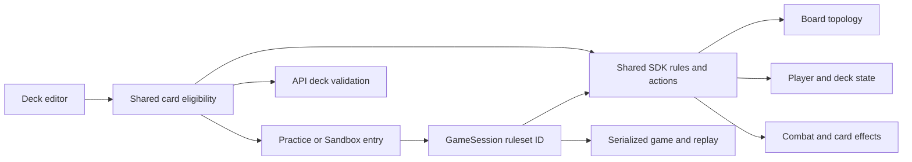

# Architecture Spine — Duelyst Practice and Sandbox rules overhaul

## Design Paradigm

Use one immutable, versioned ruleset per match within the existing shared SDK. The launch path selects the ruleset; SDK game state and actions enforce it; API and UI consume the same eligibility contract. Existing matches retain the legacy ruleset.

## Invariants & Rules

### AD-1 — Bind a ruleset to each match [ADOPTED]

- **Binds:** CAP-1–CAP-5; Practice, Sandbox, Developer Sandbox, legacy modes; saved matches and replays.
- **Prevents:** A board using hex rules while its mana or deck uses legacy rules, or Developer Sandbox accidentally inheriting Sandbox changes.
- **Rule:** The server derives ruleset ID `practice-sandbox-hex`, version `1`, from the validated Practice route; local Sandbox setup derives that same pair from the concrete Sandbox class before setup. Clients cannot choose the ruleset ID. Developer Sandbox and all other entries select `legacy`; `GameType.Sandbox` alone is insufficient. Persist the selected ID/version once in session and setup snapshots. Resolve it before board or deck construction and before replaying actions; reject unknown IDs/versions. Only historical snapshots with no ID default to `legacy`.

### AD-2 — Use one axial topology [ADOPTED]

- **Binds:** CAP-1, CAP-2; board state, targeting, movement, range, adjacency, AI, action payloads, server, and replay.
- **Prevents:** Mixed square-grid offsets, inconsistent hex distance, and mismatched stored positions.
- **Rule:** Every new-ruleset SDK position, action target, modifier target, snapshot, and replay uses `{q,r}`; legacy matches retain `{x,y}`. All SDK position producers and consumers, including AI, dispatch by ruleset; conversion is limited to explicit legacy input and display adapters. For the 45 pointy-top cells, rendered column `c = 2q + r` is 0–8 and rendered row `k = floor(r/2)` is 0–4; for each `(c,k)`, `r = 2k + (c mod 2)` and `q = (c-r)/2`. Odd columns shift down. The only axial neighbor deltas are `(1,0)`, `(-1,0)`, `(0,1)`, `(0,-1)`, `(1,-1)`, and `(-1,1)`. Shared topology code owns conversion, neighbors, distance, paths, range, and bounds. The general start cells are `(-2,4)` and `(2,4)`, the leftmost and rightmost center cells. No new-ruleset legality or effect code may use square offset patterns.

### AD-3 — Enforce rule effects in SDK actions [ADOPTED]

- **Binds:** CAP-2–CAP-4; client prediction, authoritative play, and replay.
- **Prevents:** UI-only restrictions or card-specific exceptions diverging from authoritative outcomes.
- **Rule:** The ruleset's SDK action validation enforces general-adjacent summon destinations and suppresses automatic counterattacks. The SDK owns each player's reserve and spendable mana. Opening balances are `(17,3)` and `(16,4)`; `p_endTurn` transfers `min(3,reserve)` once for its recorded ending player after ending the turn and before publishing `end_turn`, so observers see the new balance. Card play spends spendable mana. New-ruleset setup omits bonus mana tiles, and all other mana-grant actions are excluded by the eligibility policy or guarded by the ruleset. Start-turn refresh, nine-mana capping, and unspent-mana clearing are disabled only for the new ruleset. Actions and resulting state serialize deterministically.

### AD-4 — Keep new decks and hands mode-specific [ADOPTED]

- **Binds:** CAP-5; deck editor, API validation, game setup, and replay.
- **Prevents:** A 40-card deck entering a new-rules match, or new hand logic changing legacy modes.
- **Rule:** Saved deck purposes are `practice`, `sandbox`, or `legacy`; old decks default to `legacy`. Practice and Sandbox entry each require a deck with the matching purpose and exactly one general plus eight cards; existing 40-card decks remain untouched. New-ruleset deck construction, deserialization, mutation, and UI use eight slots, encoded as a length-eight array with stable indices and `null` for spent slots; play actions identify the slot and card instance, then clear that entry without splicing. Turn-end draw, mulligan, replacement, fatigue, refill, shifting, and later hand additions are unavailable. The Practice server route and local Sandbox SDK launch each reject an invalid deck before setup using the same policy; UI mirrors these constraints. This check precedes the existing `allCardsAvailable` bypass.

### AD-5 — Publish one audited card eligibility set [ADOPTED]

- **Binds:** CAP-2–CAP-5; player decks, Practice bot deck, and card effects.
- **Prevents:** A conflicting card slipping through one entry path or a local blacklist drifting from another.
- **Rule:** One shared SDK allowlist of explicit card IDs is the source of truth for both new modes; variants need their own audited IDs. Audit each admitted card's modifiers, follow-ups, generated cards, and general/signature effects against hex targeting, general-only summoning, no counterattack, reserve-only mana grants, and fixed hand slots. Apply the policy at editing, Practice API entry, local Sandbox launch, Practice bot setup, and generated-card creation; reject non-allowlisted cards at authoritative boundaries. Practice uses the exact fixed bot roster in `practice-bot-deck.md` with all eight cards in hand regardless of difficulty; Maw's nearby effect must use hex neighbors before the roster is admitted. A substituted or partly unavailable roster cannot ship. Legacy modes do not use this allowlist.

## Consistency Conventions

| Concern | Convention |
| --- | --- |
| Ruleset identity | Stable ID and version are match data, never inferred from `GameType` during replay. |
| Coordinates | Axial `{q,r}` is the sole new-ruleset SDK and wire position shape; `{x,y}` remains legacy. Display conversion happens at view adapters. |
| State mutation | SDK actions mutate match state; UI offers previews and API validates entry. |
| Compatibility | Old saved sessions lacking a ruleset ID and existing decks resolve to legacy behavior. |
| Delivery sequence | Implement and integrate board → summoning → counterattack → mana → deck and hand, as required by the Spec. |

## Structural Seed

The new ruleset, axial topology, and card eligibility policy live in the shared `app/sdk` code used by browser and server. `GameSession` owns ruleset identity; `Board` and geometry helpers consume topology; actions mutate player and deck state. Existing API and local Sandbox entry paths enforce the same eligibility contract. No new service or datastore is required by this feature. Existing Firebase game snapshots and replays carry the ruleset ID and new-ruleset coordinates; old snapshots remain legacy.

## Capability → Architecture Map

| Capability | Lives in | Governed by |
| --- | --- | --- |
| CAP-1 board | SDK board/topology, game view | AD-1, AD-2 |
| CAP-2 summoning | SDK board and summon action validation | AD-1–AD-3, AD-5 |
| CAP-3 counterattack | SDK attack/modifier action resolution | AD-1, AD-3, AD-5 |
| CAP-4 mana | SDK player and turn/card actions | AD-1, AD-3, AD-5 |
| CAP-5 deck and hand | SDK deck/setup, UI deck editor, API validation | AD-1, AD-4, AD-5 |

## Deferred

- The physical store and UI layout for mode-specific deck identities can follow existing deck persistence patterns; the identity and validation contract above are fixed.
- The complete compatible card ID set is an implementation audit output. No unaudited card enters the new modes.
- Visual hex art and animation details belong to UI implementation; they must render the topology and fixed hand slots defined here.
- Deployment topology and provider choices remain those of the existing Duelyst services; this feature adds no infrastructure component.
