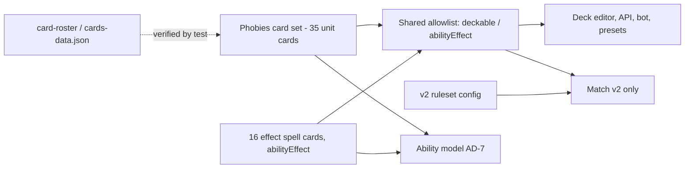

# Architecture Spine — Phobies Card Import

## Design Paradigm

Extend the parent's one-ruleset-per-match design with a separate card catalog: Phobies cards live in their own card set, enter play only through the shared allowlist, and run on the existing Entity stat model, ability model and modifier hooks. No new engine, service or datastore.



Dependency direction: cards and effects depend on the SDK stat model and modifier hooks; deck, API and UI depend on the allowlist; nothing in legacy code depends on the Phobies set.

## Inherited Invariants

| Inherited | From parent | Binds here |
| --- | --- | --- |
| AD-1 | parent spine | Imported cards are legal only in v2 matches; one helper decides v2. |
| AD-2 | parent spine | All effect geometry, including push and dash, uses axial `{q,r}`. |
| AD-3 | parent spine | Effects are enforced in SDK actions; no UI-only rule. |
| AD-4 | parent spine | Eight-slot hands; abilities never write to the hand array. |
| AD-5 | parent spine | One allowlist of explicit ids; variants have their own audited ids. Extended by AD-12. |
| AD-6 | parent spine | Stats use existing Entity setters and accessors; action points via Entity only. |
| AD-7 | parent spine | Ability is `{effectCardId, lockdown, cooldown}`; use is one action. Extended by AD-11. |
| AD-8 | parent spine | Beam, area, lobbed and Wall obstruction use the shared resolver. |
| AD-9 | parent spine | Walls and Methron Points are neutral tile entities. Values changed by AD-13. |

## Invariants & Rules

### AD-10 — Phobies variants are standalone cards in their own set [ADOPTED]

- **Binds:** CAP-1, CAP-2; card catalog, card lookup, collection, shop, crafting, random generation.
- **Prevents:** A variant inheriting the original's keywords or modifiers, an original changing, or a variant leaking into legacy card pools.
- **Rule:** Each of the 35 cards has its own card id from a reserved range and a standalone definition in the repository's factory style: one Phobies factory registered wherever existing sets register (card set lookup, set factory, card lookup, and the factory chain in `cardFactory`), in a new `Phobies` card set. Only name, sprite and icon resource references are copied from the Duelyst original; no definition is cloned or overridden from it, and a field links to the original card id. HP, attack and mana are set as factory properties (`maxHP`, `atk`, `manaCost`) and movement and attack types through `setMovementType` and `setAttackType`. Legacy pools exclude the set through one shared predicate inside the generic card-cache pool builders, so collection, shop, crafting, Gauntlet, Rift, Challenges, Boss Battle and random generation all drop it; deck editors and id lookup in Practice and Sandbox still resolve it. A test compares all 35 cards' stats to a copy of the Phobies data kept in the repository as a fixture. The display name is `[PB] ` plus the Duelyst name, applied at one display-name point so the prefix can be removed there.

### AD-11 — Each active is its own effect spell card [ADOPTED]

- **Binds:** CAP-4; ability model, hand slots, card detail view, `UseActiveAbilityAction`.
- **Prevents:** A second ability engine, effect logic hidden inside unit cards, and mana or deck rules applying to ability effects.
- **Rule:** Each of the 16 actives is a dedicated effect spell card, referenced by the unit's `effectCardId` (AD-7), reusing existing spell kinds where they exist (damage, heal, buff for the turn) and adding new kinds only for push, Wall create or destroy, move plus attack, dash, beam and self-destruct. Effect cards are the `abilityEffect` category: zero cost, use never spends mana, never deckable, absent from deck builders, not playable from the hand as a normal card; `UseActiveAbilityAction` is their only entry. Damage and healing from an effect carry the casting unit as source entity, so unit-sourced modifiers (Lifegain, Counter Attack, Body Count) see it. An effect containing a move or an attack costs exactly one action point, the ability use; the embedded move and attack actions carry `source=ability` and are exempt from the action-point check at one point only, the Entity accessor, so AD-6 holds; they still resolve as real moves and attacks so attack-related modifiers trigger. Beam and area targeting use the AD-8 resolver, and push and dash paths are added to that resolver, not computed in the effect. Each ability definition carries its own use range as an optional `range` field next to `effectCardId`, `lockdown` and `cooldown` (extending AD-7); it is separate from the unit's attack reach and is not a unit stat. A Terrorform Wall uses the AD-9 Wall entity with the v2 config Wall health.

### AD-12 — The allowlist has two roles and replaces the previous list [ADOPTED]

- **Binds:** CAP-2, CAP-7; deck editor, API validation, Sandbox launch, bot setup, saved decks.
- **Prevents:** A previously allowed card surviving in these modes, effect cards entering decks, and the bot, presets and editor reading different lists.
- **Rule:** The existing `rulesets/cardEligibility` module is extended, not replaced wholesale: it keeps its signature-card ids, generated-dependency ids and Wall and Methron tile rules, and gains the roles `deckable` (the 35 imported cards plus generals) and `abilityEffect`. Legality of an effect card stays derived from its owning unit's `effectCardId` and is never a second list. The new lists apply to v2 only, so v1 `practice-sandbox-hex` matches and replays keep their legality. Each story that adds a card registers its id here. Planar Scout and the other previously allowed cards leave `deckable`. Saved Practice and Sandbox decks containing a non-`deckable` card are deleted automatically by deck load and entry validation, the single owner of the purge. The Practice bot deck and the preset starter deck for each faction's primary General are one shared SDK data list of eight cards (`practice-bot-deck.md` of the Phobies spec), each entry validated against `deckable` at load. The 40-card faction starter decks remain for legacy modes only.

### AD-13 — v2 numeric constants live in one ruleset config [ADOPTED]

- **Binds:** CAP-5; match setup, `ResolveMethronPointControlDamageAction`, Wall setup.
- **Prevents:** General health, deficit damage and Wall health defined inline in different places, and drifting values.
- **Rule:** One v2 ruleset config object defines General health 6000, General attack and Bloodbound Spell effect amounts scaled by 100, Methron deficit damage 200 per point, and Wall health 2000. The Bloodbound scale is applied where the General's ability resolves in v2, so legacy spell cards are not edited. It replaces the inline values (Wall health 10 in the tile factory, General health 25 in each faction factory, the multiplier in the control-damage action) and is applied at v2 match setup, where General health is overridden; no other code embeds these numbers. They supersede the parent AD-9 value of two damage per point and the map spec's ten-health Wall, and this treats v2 as not yet released, which weakens the parent AD-1 reading that a ruleset version is immutable. v1 and other modes keep their values. Saved v2 matches, replays and snapshots made under the old values are purged by the project owner; there is no migration and no per-match constant storage.

### AD-14 — Passives and Lifegain are modifiers on existing hooks [ADOPTED]

- **Binds:** CAP-3, CAP-6; modifiers, damage and heal actions, card effect text.
- **Prevents:** Passive behavior hard-coded in actions, Lifegain duplicating the existing heal-on-damage modifier, and legacy cards gaining the behavior.
- **Rule:** Lifegain is the existing `ModifierHealSelfWhenDealingDamage` given an optional ratio parameter (default 1.0, so every existing use is unchanged), restoring `floor(ratio × damage dealt)` capped at missing Health; it counts all damage the unit deals, including ability damage, and Phobies cards attach it at ratio 0.5. Each passive (Body Count, Counter Attack at 35% rounded down and never triggered by another Counter Attack's reflected damage, Regatorate, Rage, Heart Attack) uses an existing modifier where one fits (for example a start-of-turn or kill-watch modifier) and is otherwise a card-specific modifier on existing hooks; Heart means the General. Nothing may attach these modifiers to a non-Phobies card. Effect text is worded in Duelyst terminology per `card-roster.md`.

### AD-15 — Reuse before create [ADOPTED]

- **Binds:** CAP-3, CAP-4, CAP-6; every modifier, spell, action and validator added for this epic.
- **Prevents:** Near-duplicate modifiers, spells or actions, and divergence from how the repository already builds cards and effects.
- **Rule:** Before adding any modifier, spell kind, action or validator, search the existing SDK for one that fits, and prefer in order: use as is, extend with an optional parameter whose default keeps current behavior, then create new. A new one is allowed only when none fits, and the story that adds it records which existing ones were reviewed. New code follows the surrounding file's naming, structure and comment density, and registers where existing ones register.

### AD-16 — Effect cards declare their presentation from existing FX [ADOPTED]

- **Binds:** CAP-4; effect spell cards, game view, sound.
- **Prevents:** Per-ability ad hoc animation code and new FX assets for abilities.
- **Rule:** Each effect card declares, in the same card fields spells already use for FX, sound and animation, a reveal animation (card back, then reveal) shown only when the opponent uses the ability, never for the player's own use, a caster-side effect and a target-side effect chosen from existing Duelyst FX by the name in the `card-roster.md` FX table; sound is taken from the sound resources of the same original cards and modifiers the roster names (for example a spell's `setBaseSoundResource`), and each story verifies the sound plays in the running game. The game view decides whether an action shows a played card with `PlayCardFromHandAction or SignaturePlay.matches(action)` in several places (game layer, battle log, battle log node, player, game layout). A unit ability is a `UseActiveAbilityAction` with a unit source, which neither test matches (a General ability already matches `SignaturePlay`), so the view uses one shared played-card test that also accepts unit abilities in all of those places, while the SDK modifiers that use the same tests are left unchanged. Presentation is client-side only and never changes action outcomes. The roster's FX name table, taken from the local Card Gallery composites, maps each name to its composite id and is the lookup. A named FX that cannot be resolved to an existing resource is reported in the story, not substituted silently.

### AD-17 — Ability execution semantics [ADOPTED]

- **Binds:** CAP-3, CAP-4, CAP-6; effect cards, attack-less units, timed effects, Lifegain.
- **Prevents:** Two stories choosing different durations, target classes or damage bases for the same effect.
- **Rule:** Attack-less units (BOOM, KABOOM, Cupcake, Rusty) have attack type `none`, added to the existing attack-type values with no change to defaults; such a unit cannot attack. Immobilize (cannot move) does not stop an effect's embedded move and does not pause Lockdown or Cooldown counters; the ability stays usable. Silence blocks the ability and pauses its counters (AD-7). A stunned unit cannot use its ability. Other restrictions follow the existing Entity accessors (AD-6). "This turn" effects end at the casting owner's turn end; "N turns" effects lose one turn at the end of each of the affected unit's owner's turns. Peek-a-booOO! lasts 2 turns. For these 16 effects only, and with no change to any other effect in the game: damage, push, dash, immobilize and debuff effects may target any unit including Generals; healing and Attack-boost effects target friendly minions only. Neutral Walls are targets only where the map spec's obstruction and area rules say so. Lifegain restores `floor(0.5 ×` the damage actually applied, after defenses`)`, capped at missing Health.

## Consistency Conventions

| Concern | Convention |
| --- | --- |
| Card identity | Standalone id, `Phobies` set, link to original id; never match by name. |
| Eligibility | Only the allowlist decides deck and effect-card legality (AD-12). |
| Ruleset numbers | Read from the v2 config (AD-13); no inline literals. |
| Action budget | Entity accessors only; ability-sourced embedded actions spend no points (AD-11). |
| Effect cards | `abilityEffect` category, zero mana, not deckable (AD-11). |
| Modifier scope | Phobies modifiers are attached only to Phobies cards (AD-14). |
| Presentation | Existing FX by roster name; client-only (AD-16). |
| Reuse | Use, then extend with a default-preserving parameter, then create; record what was reviewed (AD-15). |
| Stat verification | One test compares all 35 cards to `cards-data.json` (AD-10). |

## Structural Seed

```text
app/sdk/cards/factory/phobies/   # unit cards and effect spell cards, one factory file each
app/sdk/modifiers/               # ratio parameter on the heal-on-damage modifier; card-specific passives only where none fits
app/sdk/rulesets/                # v2 config, allowlist roles, shared bot/preset list
```

## Capability → Architecture Map

| Capability | Lives in | Governed by |
| --- | --- | --- |
| CAP-1 variant cards | Phobies factory, card set | AD-10 |
| CAP-2 Practice/Sandbox only | Allowlist, card pools | AD-1, AD-10, AD-12 |
| CAP-3 passives | Phobies modifiers | AD-14, AD-15 |
| CAP-4 actives | Effect spell cards, ability model | AD-7, AD-8, AD-11, AD-15, AD-16 |
| CAP-5 General health, Methron damage, Wall health | v2 config, setup, control-damage action | AD-9, AD-13 |
| CAP-6 Lifegain | Existing heal-on-damage modifier with ratio | AD-14, AD-15 |
| CAP-7 allowed list, bot deck, presets | Allowlist module, bot setup, deck select | AD-4, AD-5, AD-12 |
| CAP-8 AI uses abilities | Practice AI agent actions | AD-7, AD-11 |

## Deferred

- Prismatic and skin ids auto-generated for the new cards; on hold until a need appears.
- Practice AI ability use follows the AD-7 ability action and the existing balanced policy; evaluation weights are tuning.
- Per-effect implementation of the 16 actives beyond the new spell kinds listed in AD-11; stories decide each.
- Deck-builder presentation of imported cards; the allowlist reset hides originals, so no marker is specified.
- Level mechanics, action-point display and further cards remain deferred as in the parent spine.
